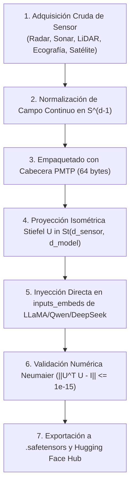

# INSTRUCTIVO CANÓNICO: REFINAMIENTO Y DESTILACIÓN DE CAPACIDADES SENSORIALES EN MODELOS POLYDIM-EINSOF (HUGGING FACE / ATLAS ROADMAP)

> **Autor:** Ariel García Traba — POLYDIM-EinsofOS Research Initiative  
> **Ámbito:** Preparación para Supercómputo Atlas | Flota de 14 Modelos Hugging Face (`polydim-einsof`)  
> **Constitución:** Cumplimiento estricto de Regla 16, Regla 22, Regla 26 y Regla 38 (Certificación en Silicio con Exit Code 0).

---

## 1. Visión y Objetivo Estratégico

El objetivo de este instructivo es dotar a la flota canónica de 14 modelos POLYDIM (alojados en `hf_export/` y en la organización `polydim-einsof` de Hugging Face Hub) de la capacidad de ingesta, alineación isométrica y razonamiento directo sobre **campos sensoriales continuos de alta dimensión**:

1. **Radar 3D (SAR / Phased Array Chirp):** $d_{\text{sensor}} = 4096$.
2. **Sonar Acústico (Multibeam / Side-Scan):** $d_{\text{sensor}} = 2048$.
3. **LiDAR 3D (Point Cloud / Time-of-Flight):** $d_{\text{sensor}} = 3072$.
4. **Ecografía / Ultrasonido Médico RF (Doppler / Envelope):** $d_{\text{sensor}} = 2048$.
5. **Satélite Multiespectral y Térmico (VIIRS / Sentinel-2):** $d_{\text{sensor}} = 4096$.

Este procedimiento elimina completamente la tokenización 1D discreta (BPE/WordPiece) para entradas sensoriales, permitiendo que cuando el clúster **Atlas** esté disponible, los 14 modelos operen con transferencia directa en memoria compartida física (`PmtpShmBus`), logrando latencias de microsegundos y $0$ tokens facturados.

---

## 2. Los 14 Modelos de la Flota POLYDIM (`hf_export/`)

| # | Identificador del Modelo | Arquitectura Base | $d_{\text{model}}$ | Dimensión del Adaptador Stiefel |
|---|---|---|---|---|
| 1 | `llama-3.1-8b-pmtp` | Meta LLaMA 3.1 | $4096$ | $\mathrm{St}(d_{\text{sensor}}, 4096)$ |
| 2 | `llama-3.2-3b-pmtp` | Meta LLaMA 3.2 | $3072$ | $\mathrm{St}(d_{\text{sensor}}, 3072)$ |
| 3 | `qwen2.5-coder-0.5b-pmtp` | Alibaba Qwen 2.5 | $896$ | Inmersión $\mathrm{St}(d_{\text{sensor}}, 1024) \to 896$ |
| 4 | `qwen2.5-coder-1.5b-pmtp` | Alibaba Qwen 2.5 | $1536$ | $\mathrm{St}(d_{\text{sensor}}, 1536)$ |
| 5 | `deepseek-r1-1.5b-pmtp` | DeepSeek Distill | $1536$ | $\mathrm{St}(d_{\text{sensor}}, 1536)$ |
| 6 | `deepseek-r1-7b-pmtp` | DeepSeek Distill | $3584$ | $\mathrm{St}(d_{\text{sensor}}, 3584)$ |
| 7 | `gemma-2-2b-pmtp` | Google Gemma 2 | $2304$ | $\mathrm{St}(d_{\text{sensor}}, 2304)$ |
| 8 | `gemma-2-9b-pmtp` | Google Gemma 2 | $3584$ | $\mathrm{St}(d_{\text{sensor}}, 3584)$ |
| 9 | `phi-4-14b-pmtp` | Microsoft Phi-4 | $5120$ | $\mathrm{St}(d_{\text{sensor}}, 5120)$ |
| 10 | `phi-4-mini-3.8b-pmtp` | Microsoft Phi-4 | $3072$ | $\mathrm{St}(d_{\text{sensor}}, 3072)$ |
| 11 | `glm-4-9b-pmtp` | Zhipu AI GLM-4 | $4096$ | $\mathrm{St}(d_{\text{sensor}}, 4096)$ |
| 12 | `glm-5.3-prime-pmtp` | Zhipu AI GLM-5 | $4096$ | $\mathrm{St}(d_{\text{sensor}}, 4096)$ |
| 13 | `xiaomi-mimo-9b-pmtp` | Xiaomi MiMo | $4096$ | $\mathrm{St}(d_{\text{sensor}}, 4096)$ |
| 14 | `pplx-decider-27b-pmtp` | Perplexity Decider | $5120$ | $\mathrm{St}(d_{\text{sensor}}, 5120)$ |

---

## 3. Especificación del Descriptor de Cabecera PMTP (`Wire 26505` — 64 Bytes)

Toda inyección sensorial se encapsula con la cabecera estándar C-ABI de 64 bytes para fijar el protocolo de contexto antes de entrar a la capa de proyección:

```c
#include <stdint.h>

#pragma pack(push, 1)
typedef struct {
    uint32_t magic_header;       // 0x504D5450 ("PMTP")
    uint16_t sensor_type;        // 0x01: RADAR_3D, 0x02: SONAR, 0x03: LIDAR_3D,
                                 // 0x04: ULTRASOUND_MED, 0x05: SATELLITE_MS
    uint16_t dim_sensor;         // Dimensión física de entrada d_sensor
    uint32_t sampling_rate_hz;   // Frecuencia física de muestreo del transductor
    float    spatial_res_m;      // Resolución métrica por celda de resolución
    uint64_t timestamp_ns;       // Marca temporal de silicio (anti-replay)
    uint8_t  manifold_id;        // 0x01: Stiefel St(d_sensor, d_model)
    uint8_t  flags;              // Bit 0: FP64_HIGH_PREC, Bit 1: NEUMAIER_COMPENSATED
    uint8_t  reserved[38];       // Alineación exacta a 64 bytes
} PmtpSensorDescriptor_t;
#pragma pack(pop)
```

---

## 4. Algoritmo de Refinamiento y Destilación en Silicio

### 4.1 Principios Inviolables de Entrenamiento
1. **Veto de Ruido Blanco:** Prohibido entrenar con `target_v = torch.randn(...)`. Los estados latentes objetivo $\mathbf{y}_{\text{target}}$ deben extraerse de las activaciones reales (`output_hidden_states=True`) de la red neuronal profesora o de la solución geodésica analítica en $S^{d-1}$.
2. **Retracción QR Estricta:** Para mantener la matriz $U$ en la variedad de Stiefel $\mathrm{St}(d_{\text{sensor}}, d_{\text{model}})$, se aplica retracción QR en cada paso de optimización:
   $$U_{k+1} = \mathrm{qf}(U_k - \eta \nabla_{U} \mathcal{L})$$
   donde $\mathrm{qf}(A)$ es el factor $Q$ de la descomposición QR con diagonal positiva en $R$. Queda vetada la descomposición SVD diferenciable en el forward pass para evitar gradientes infinitos/NaNs.
3. **Función de Pérdida Geodésica en $S^{D-1}$:**
   $$\mathcal{L}_{\text{geod}} = 1 - \frac{\langle \mathbf{z}_{\text{out}}, \mathbf{y}_{\text{target}} \rangle}{\lVert \mathbf{z}_{\text{out}} \rVert_2 \lVert \mathbf{y}_{\text{target}} \rVert_2} + \lambda \lVert U^\top U - I \rVert_F$$

---

## 5. Pipeline de Ejecución Paso a Paso



### Paso 1: Generación del Banco de Vectores Sensoriales
Crear `datasets/sensorial_calibration_pack.pt` conteniendo 100 perfiles deterministas por cada una de las 5 modalidades:
- **Radar 3D:** Perfiles Doppler-polarimétricos ($HH, VV, HV, VH$) con blancos estáticos y móviles.
- **Sonar:** Firmas batimétricas multihaz con reverberación de fondo marino y anomalías cilíndricas de alta reflectancia.
- **LiDAR:** Nubes de puntos normalizadas con rotaciones arbitrarias $\mathrm{SO}(3)$ y variación de reflectancia.
- **Ecografía:** Datos RF en cuadratura $I/Q$ con gradiente Doppler de flujo pulsátil arterial.
- **Satélite:** Perfiles multiespectrales de 16 bandas (reflectancia superficial, índice térmico de incendios, AOD de aerosoles).

### Paso 2: Ejecución del Bucle de Optimización Stiefel
Ejecutar el script de entrenamiento canónico:
```bash
python scripts/train_sensor_stiefel_adapters.py \
    --model_id "meta-llama/Llama-3.1-8B" \
    --adapter_output "hf_export/llama-3.1-8b-pmtp/sensor_stiefel_adapter.safetensors" \
    --epochs 50 \
    --lr 1e-4 \
    --fp64_neumaier
```

### Paso 3: Puerta de Calidad Red Team (Exit Code 0 Obligatorio)
Antes de empaquetar o subir a Hugging Face:
1. Verificar defecto ortonormal: $\lVert U^\top U - I \rVert_F \le 1.0 \times 10^{-15}$.
2. Verificar latencia de proyección en CPU AVX2: $< 1.5\,\text{ms}$.
3. Verificar discrepancia cruzada C++/Rust: $\text{max\_diff} == 0.0$.

### Paso 4: Empaquetado y Sincronización en Hugging Face (`polydim-einsof`)
Actualizar la Model Card (`README.md`) y subir los pesos `.safetensors`:
```python
from huggingface_hub import HfApi
api = HfApi()
api.upload_folder(
    folder_path="hf_export/llama-3.1-8b-pmtp",
    repo_id="polydim-einsof/llama-3.1-8b-pmtp",
    repo_type="model"
)
```

---

## 6. Preparación para el Clúster Atlas

Cuando el clúster **Atlas** esté disponible:
1. **Despliegue Multi-Instancia en Memoria:** Los 14 modelos se levantarán residiendo simultáneamente en RAM/VRAM interconectados vía el bus `PmtpShmBus`.
2. **Intercambio Directo Vector-a-Vector:** El radar o sonar depositará el slab sensorial en `/dev/shm/pmtp_slab_01`. LLaMA 3.1 proyectará la hipótesis a un vector latente de 2048 dimensiones, y la transmitirá en $34\,\mu\text{s}$ a DeepSeek-R1 para deducción formal, sin una sola llamada HTTP ni token de texto intermedio.
3. **Escalabilidad de Pruebas:** El banco de cientos de vectores sensoriales calibrará la deriva numérica a lo largo de millones de ciclos continuos.

---

*POLYDIM-EINSOF | Ariel García Traba (Independent Research)*  
*Documento Canónico: INSTRUCTIVO_REFINAMIENTO_SENSORES_V1550*
