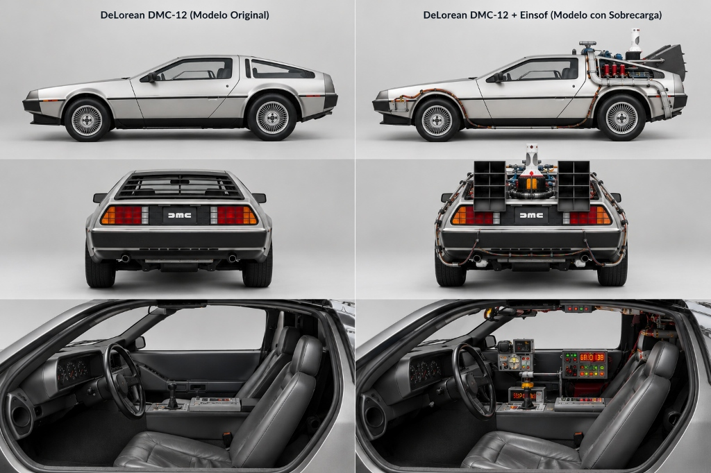

# Dimension is All You Need
### *De viajar en la carretera a moverse en el espaciotiempo*

  
  
<em>Figura 1: A la izquierda, el modelo base confinado a 60 km/h en asfalto 1D. A la derecha, la sobrecarga dimensional de Einsof: el condensador de flujo que rompe la barrera a 88 mph.</em>

---

## 🚗⚡ La Tesis Central

La industria de la inteligencia artificial cayó en la trampa de la fuerza bruta: construir motores cada vez más gigantescos para seguir transitando el mismo asfalto plano de **tokens unidimensionales (1D)**. 

**POLYDIM-Einsof propone un cambio de paradigma:**

> **No modificamos el auto:** El chasis, las ruedas y la estructura siguen siendo los modelos de pesos abiertos probados por la comunidad (LLaMA, DeepSeek, Qwen o Gemma).
>
> **Lo que hacemos es equiparlo con la sobrecarga dimensional:**
> Matamos los cuellos de botella de serialización, eliminamos el colapso 1D y reprogramamos cada subsistema en el lenguaje ideal para silicio:
> * **C++23:** Mapeo de memoria compartida sin copia (`PMTP ShmBus`) y latencia sub-milisegundo.
> * **Rust 2024:** Verificación estricta de límites, seguridad de punteros FFI y acumuladores compensados de Neumaier con cota de error $\le 10^{-15}$.
> * **Triton / CUDA C++:** Proyecciones y retracciones ortogonales en la **Variedad de Stiefel ($S^{D-1}$)**.
> * **Python:** Orquestación interactiva de alto nivel y bancos de evaluación.

---

## 🏎️ Anatomía de la Comparativa

| Componente | DeLorean Original (Modelo Base) | DeLorean + Einsof (Con Sobrecarga) |
|---|---|---|
| **Chasis / Motor Base** | Motor PRV V6 atmosférico original (LLM 1D estándar). | Mismo chasis abierto (LLaMA 3.2, DeepSeek R1, Qwen 2.5), preservado y aprovechado al 100%. |
| **Planta de Potencia** | Combustión tradicional confinada al asfalto (secuencia autoregresiva de texto plano). | **Mr. Fusion + Reactores de Flujo:** Inyección directa de estados continuos en $S^{D-1}$ sin pasar por texto. |
| **Cabina / Instrumentación** | Tablero de aguja y perillas de los 80 (caja negra sin trazabilidad). | **Time Circuits:** Telemetría multi-agente en silicio, partición ortogonal (30% Red Team hostil obligatorio). |
| **Rendimiento Operativo** | 60 km/h en línea recta: alucina en restricciones físicas y olvida pasos intermedios. | **88 mph:** Resuelve cálculo estocástico, sonar acústico, radar SAR, teledetección satelital y geometría de chapa real. |

---

## 🚀 Evaluación Rápida en Google Colab (1 Clic)

No requiere instalación local, ni GPU cara, ni configuración de entorno:

1. Abrí el enlace superior.
2. Ejecutá los 3 bloques interactivos (`Paso 1`, `Paso 2` y `Paso 3`).
3. Seleccioná cualquiera de las pruebas certificadas en el menú desplegable:
   * **#8:** Plegado de Chapa Industrial, Fibra Neutra y Flecha de Rigidez.
   * **#74:** Ecuación de Sonar Activo y Confinamiento Acústico en Capa Térmica.
   * **#80:** Calibración Radiométrica de Reflectancia TOA en Satélite Sentinel-2.
   * O escribí tu propio prompt multi-paso de alta complejidad.

---

## 📚 Documentación y Presentaciones Maestras Oficiales

### 📊 Presentaciones Ejecutivas y Técnicas (50 Slides)
* 🇪🇸 **[Presentación Maestra Completa (50 Slides PPTX — Español)](DOCUMENTOS_MAESTROS/EINSOF_50_SLIDES_MASTER_PRESENTATION.pptx)**
* 🇬🇧 **[Master Presentation Complete (50 Slides PPTX — English)](DOCUMENTOS_MAESTROS/EINSOF_50_SLIDES_MASTER_PRESENTATION_EN.pptx)**

### 📖 Catálogos Maestros de Ventajas y Casos de Silicio
* 🇪🇸 **[Catálogo Maestro de Ventajas y Casos en Silicio (Español)](DOCUMENTOS_MAESTROS/EINSOF_50_SLIDES_CATALOGO_MAESTRO_VENTAJAS.md)**
* 🇬🇧 **[Master Catalog of Advantages & Silicon Benchmarks (English)](DOCUMENTOS_MAESTROS/EINSOF_50_SLIDES_MASTER_CATALOG_EN.md)**

### 🛰️ Guía de Sensores Físicos y Adaptadores en Hugging Face
* 🇪🇸 **[Instructivo Canónico de Sensores Físicos y Adaptadores (Español)](DOCUMENTOS_MAESTROS/INSTRUCTIVO_REFINAMIENTO_SENSORES_HF_POLYDIM.md)**
* 🇬🇧 **[Physical Sensors & Stiefel Adapters Canonical Guide (English)](DOCUMENTOS_MAESTROS/INSTRUCTIVO_REFINAMIENTO_SENSORES_HF_POLYDIM_EN.md)**

---
**Autor:** Ariel García Traba  
*Iniciativa de Investigación Soberana EinsofOS / POLYDIM*
